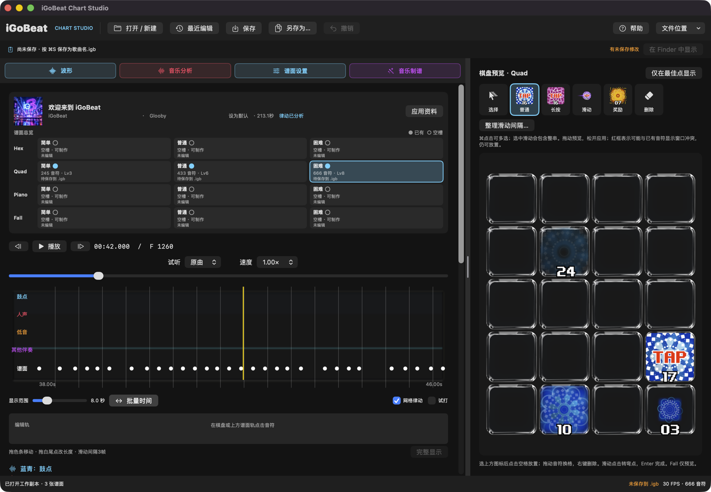

# iGoBeat Chart Studio

独立 Mac 曲谱编辑器 · 0.17.1 测试版

[下载安装包](https://github.com/GloobyFF/iGoBeat-Chart-Studio/releases/tag/v0.17.1) · [图文使用指南](docs/EditerHelp.html) · [网站帮助](https://www.igobeat.com/EditerHelp.html)

## 0.17.1 更新

- 修复分轨试听，播放实际人声、鼓、低音或其他伴奏；切换保留播放位置、速度与状态。
- 保存 .igb 时携带压缩试听分轨，重新打开或换 Mac 可继续试听。
- 缺失、过期或损坏的分轨会明确提示，不再静默播放原曲。

## 安装

支持 Apple Silicon（M1 或更新）及 macOS 14+。下载 Release 中的 `iGoBeat-Chart-Studio-0.17.1-macOS-arm64.zip`，解压后把 `Distribution/iGoBeat Chart Studio.app` 拖入应用程序，双击启动。不需要安装 Xcode 或 Python。

本版是 ad-hoc 签名、尚未 Developer ID 公证的测试版本。如被 macOS 拦截，核对来源后在“系统设置 → 隐私与安全性”选择“仍要打开”。不要关闭系统安全保护。暂不提供 Intel、Windows 或 iPhone 版安装包。

内置 Python、htdemucs 与 madmom 分析模型，可离线编辑、四分轨和检测起音/节拍。解压约 1.2 GB；分析需要额外工作空间。分析不等同于逐字歌词识别，需要人工听审。

## 使用

打开音乐或 `.igb` → 选择玩法与难度 → 编辑/分析 → ⌘S 保存。所有难度与玩法保存在同一个 `.igb`。

- 图形音符工具、长按/滑动编辑、批量调时和模式转换。
- Quad / Hex 自动制谱规则与导入谱面参考。
- Fall 转换与预览，不支持逐格编辑。
- 工具栏“帮助”打开内置离线图文说明。
- 关闭时可选“保存 / 取消 / 放弃所有修改”；放弃仅丢弃未保存草稿，保留已保存曲包。
- 工作缓存：`~/Library/Application Support/iGoBeat Chart Studio/Workspace`。

## 授权与范围

这是用于非商业制作与测试的分发仓库，不是开源游戏源码仓库。未另行授予编辑器源码、美术或品牌的再许可权。本包不包含歌曲、个人草稿或凭据。

第三方组件保留各自许可证。madmom 模型使用 **CC BY-NC-SA 4.0**，商业用途需向权利人另行取得许可；htdemucs / Demucs 为 MIT。完整组件与许可证位于 App 的 `Contents/Resources/ThirdPartyNotices` 及内置 Python 目录。

## 维护与校验

每次版本发布使用独立 tag 与附件，不覆盖旧版文件。Release 包含 App ZIP、网站静态 ZIP 和 `SHA256SUMS.txt`；下载后可运行 `shasum -a 256 -c SHA256SUMS.txt` 校验两个 ZIP。

网站上传包 `EditerHelp-website.zip`：将 `EditerHelp.html` 与 `editor-help-assets` 一起上传网站根目录。正式网站由维护者另行上传，GitHub 发布不等于网站已更新。

本次验证：分发 App 的 20 项分轨试听检查、24 项文档保存/放弃检查通过；ZIP 完整性和签名通过，运行时依赖已重新检查。未在另一台物理 Mac 上验收，也未做 Apple 公证。
